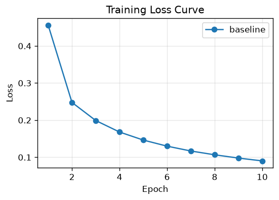
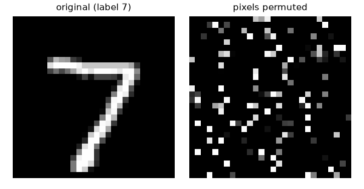

# NumPy 2층 신경망으로 MNIST 손글씨 숫자 인식

딥러닝 프레임워크 없이 NumPy만으로 `Affine → ReLU → Affine → Softmax + Cross Entropy`의 forward와 backward, SGD, 학습 루프를 직접 구현했다.

- 팀: (팀명) · 김영민, 백찬, 김민희
- 결과: MNIST test 정확도 9.87% → **97.05%** (10 epoch, 약 2초)
- 추가 실험: 픽셀 순서를 섞어도 정확도가 그대로다 → MLP는 픽셀의 위치는 알지만 이웃 관계는 쓰지 않는다

## 1. 구조와 shape

한 배치(B = 128) 기준이다.

```text
forward   x (128, 784) → Affine1 (128, 128) → ReLU (128, 128) → Affine2 = logits (128, 10) → Softmax + CE → loss
backward  dlogits (128, 10) → dW2 (128, 10), db2 (10,) → ReLU → dW1 (784, 128), db1 (128,)
update    W ← W − lr · dW    (파라미터 4개, 총 101,770개)
```

학습 한 번은 Forward → Loss → Backward → Update다. backward는 forward가 저장한 값(`x`, `mask`, 확률)을 쓰고, update는 backward가 채운 gradient를 쓰기 때문에 이 순서여야 한다.

## 2. 직접 구현한 계산

| 층 | forward | backward |
| --- | --- | --- |
| Affine | `y = x @ W + b` | `dW = x.T @ dout`, `db = dout.sum(axis=0)`, `dx = dout @ W.T` |
| ReLU | x ≤ 0인 자리를 mask로 저장하고 0으로 | mask 자리의 dout을 0으로 |
| Softmax + CE | 행 최댓값을 빼고 exp → 행 합으로 나눔 → 정답 확률의 −log 평균 | `(확률 − one-hot) / B` |
| SGD | `param -= lr * grad` (제자리 갱신) | |

구현하면서 잡은 핵심 세 가지:

- **chain rule은 경로마다 곱하고, 경로끼리 더하는 것이다.** W는 배치의 모든 샘플이 같이 쓰니까 샘플마다 `dout · x`를 구해 더해야 한다. 그걸 한 번에 하는 게 `x.T @ dout`이다. b도 같은 이유로 batch 방향으로 합한다.
- **max-shift**: e^(z−c)를 쓰면 분자와 분모에서 c가 약분돼서 확률이 같다. 행 최댓값을 빼면 exp 입력이 0 이하라 overflow가 나지 않는다.
- **제자리 갱신**: 레이어의 W와 params dict가 같은 배열이다. `params[k] = params[k] - ...`처럼 새 배열을 만들면 레이어는 옛 가중치를 계속 쓴다. `-=`로 내용을 바꿔야 학습이 된다.

## 3. 검증

| 검증 | 결과 |
| --- | --- |
| 단위 테스트 (`pytest tests/`) | 36 passed |
| 초기 loss | logits가 모두 같으면 ln 10 = 2.3026. 초기 모델에 MNIST 128장을 넣으면 2.4359 |
| gradient check (수치 미분 vs backward) | 최대 상대 오차 4.82e-08 (허용 1e-6) |
| 인공 데이터 smoke (Adam) | loss 1.650 → 0.007, 파라미터 4개 모두 바뀜 |

## 4. MNIST baseline

hidden 128, SGD lr 0.1, batch 128, 10 epoch, seed 0



| 항목 | 값 |
| --- | --- |
| epoch loss | 0.4561 → 0.0903 |
| test 정확도 | 학습 전 9.87% → 학습 후 97.05% (train 97.72%) |

- 학습 전 모델은 test 10000장 중 7587장을 "2"로 찍었다. 학습 후에는 예측이 10개 클래스에 고르게 퍼졌다.
- 첫 epoch loss가 2.30이 아니라 0.4561인 이유: epoch loss는 469개 배치 loss의 평균이고, 그동안에도 학습이 계속 진행되기 때문이다.

## 5. 추가 실험: 픽셀 순서를 섞으면?

> 이미지를 1D로 펴서 넣고 위치 정보도 따로 안 준다. positional embedding을 주면 더 잘 배우지 않을까?

784개 픽셀의 순서를 무작위로 한 번 섞고(train과 test 모두 같은 순서), baseline과 같은 설정으로 학습했다.



| 입력 | loss | test 정확도 |
| --- | --- | --- |
| 원본 | 0.456119 → 0.090278 | 97.05% |
| 픽셀 섞음 | 0.457394 → 0.091481 | 97.09% |
| 픽셀 섞음 + W1 행도 같은 순서로 섞음 | 0.456119 → 0.090278 | 97.05% |
| 위치마다 정해진 값 p를 더함 (x + p) | 0.455925 → 0.090537 | 97.08% |

- **MLP는 위치를 이미 안다.** 픽셀 i는 항상 W1의 i번째 행하고만 곱해진다. 그래서 W1의 행을 같은 순서로 섞으면 계산이 원본과 소수점까지 같다.
- **positional embedding은 b에 흡수된다.** `(x + p) @ W1 + b = x @ W1 + (p @ W1 + b)`이고, `p @ W1`은 모든 샘플에 똑같은 상수다.
- **MLP가 안 쓰는 건 이웃 관계다.** 사람 눈에는 노이즈로 보이는 이미지로도 똑같이 배운다. "옆 픽셀끼리 붙어 있다"는 정보를 원래부터 쓰지 않았다는 뜻이다. 이웃을 보는 구조는 CNN이다. positional embedding은 Transformer나 ViT처럼 모든 위치에 같은 가중치를 쓰는 구조에서 필요하다.

## 6. 막혔던 것

| 증상 | 원인과 해결 |
| --- | --- |
| `(4, 10)`과 `(4,)`의 broadcast 에러 | 행별 합이 `(N,)`이 돼서 열 방향에 맞춰졌다 → `keepdims=True`로 `(N, 1)` 유지 |
| `y_prob[y_true] - 1`에서 IndexError | 인덱스를 하나만 주면 행을 고른다 → `[np.arange(N), y_true]`로 행과 열을 둘 다 지정 |
| `TypeError: backward() missing 'dout'` | criterion backward의 반환값을 버렸다 → 그 값을 model backward에 dout으로 넘김 |

## 실행

```bash
conda activate mnist-nn
python tools/selfcheck.py --all     # 전체 테스트와 shape trace
python tools/permuted_mnist.py      # 5번 실험 표와 docs/ 그림 다시 만들기
```

- 환경 설치, Day별 구현 범위, 완료 기준 같은 과제 원래 안내는 [docs/ASSIGNMENT.md](docs/ASSIGNMENT.md)에 있다.
- 구현 과정과 검증 근거는 [REPORT.md](REPORT.md)와 [LEARNING_LOG.md](LEARNING_LOG.md)에 있다.
